  <b>Brian</b> · Hanoi, Vietnam 
  <i>Building software. Recording lessons. Sharing knowledge.</i>

  

---

I build the frame around the work, not just the work.

An AI agent allowed to edit anything will eventually edit the wrong thing. A spec nobody can grep drifts by the fortieth document. A lesson that lives in one person's head gets learned again on the next project, at full price. So the guardrail ships with the feature, the requirement ID ships with the requirement, and the note ships with the incident.

**[agent-harness-bootstrap](https://github.com/nguyenhx2/agent-harness-bootstrap)** - two Claude Code skills. `spec-builder` turns an idea, a transcript or a pile of legacy docs into a contract you and the AI both read the same way. `harness-bootstrap` reads your repo and generates the `.claude/` frame the agent runs inside. The guardrails are hooks and deny rules: shell scripts, exit codes, glob matching. Not one of them asks the model, so swapping every agent from Opus to Haiku leaves the safety floor byte-identical. The [guardrail eval](https://github.com/nguyenhx2/agent-harness-bootstrap/tree/main/eval) runs 69/69 per hook flavor, 138/138 with the bash and PowerShell hooks both installed. Thirty-five of those cases check the inverse: that the harness does not block legitimate work, and that a malformed payload does not make a hook crash. A hook that crashes fails open, which looks like protection and provides none.

Start here: **[what it does](https://github.com/nguyenhx2/agent-harness-bootstrap#-what-it-does)** - four failure modes of an unmanaged agent and what stops each one. Then [the quickstart](https://github.com/nguyenhx2/agent-harness-bootstrap#-quickstart), or [the slides](https://nguyenhx2.github.io/agent-harness-bootstrap/presentation/) if you would rather be shown.

**[Engineering Journal](https://www.engineeringjournal.dev/)** - a living notebook for modern engineering. Notes from actually building the thing. Not a news blog.

**[From Ground to Cloud](https://fromgroundtocloud.com/)** - a vendor-neutral guide to cloud computing, published in English, Vietnamese and Japanese. Cloud is not a place, it is an operating model.

Also public: **[ggchat-manager](https://github.com/nguyenhx2/ggchat-manager)**, a self-hosted tool for Google Chat at scale - bulk membership changes, message revoke, and a conversation export that opens as one standalone HTML file. **[Antigravity-AutoPilot](https://github.com/nguyenhx2/Antigravity-AutoPilot)** ([npm](https://www.npmjs.com/package/antigravity-autopilot)) does the opposite of the harness on purpose: it auto-approves every tool call and terminal command in Antigravity, for the throwaway repos where a confirmation prompt buys you nothing.

---

Three rules I hold myself to:

- An unknown never becomes an invented fact. It becomes a flagged assumption with a named owner.
- If a rule matters, make it fail the build. Advice that only advises gets ignored.
- Write it down in the language the reader thinks in.

<b>日本語</b>

 

仕事そのものだけでなく、その周りの枠組みを作っています。何でも編集できるAIエージェントは、いずれ編集してはいけないものを編集します。grepできない仕様書は、40本目のドキュメントで必ずずれます。誰かの頭の中だけにある教訓は、次のプロジェクトで同じ代償を払って学び直すことになります。だから機能にはガードレールを、要件には要件IDを、障害にはその記録を添えて出します。

**[agent-harness-bootstrap](https://github.com/nguyenhx2/agent-harness-bootstrap)** はClaude Code向けの2つのスキルです。ガードレールはフックとdenyルール、つまりシェルスクリプトと終了コードで実装されており、モデルの判断には一切依存しません。全エージェントをOpusからHaikuに入れ替えても、安全性の下限はバイト単位で変わりません。ガードレールevalはフック方式ごとに69/69、bashとPowerShellの両方を入れた場合は138/138で通ります。

Most of what is here is working notes. The links above are the ones worth your time.

